<div align="center">

# CSCI 545 / 745 — Big Data Analytics

### Comprehensive Study Notes: Big Data, Hadoop, HDFS, MapReduce, YARN, Apache Spark & PySpark


**A clean, structured, visual version of the complete CSCI 545 / 745 Big Data Analytics study notes.**

</div>

---

## About this repository

This repository reorganizes the complete course notes into a single readable GitHub `README.md`. The material covers the progression from **Big Data fundamentals** to **Hadoop**, **HDFS**, **MapReduce**, **YARN**, and finally **Apache Spark / PySpark**. All figures contained in the source notes are preserved in the relevant sections.

> **Scope note:** The technical wording and version-specific ideas here follow the provided course notes, especially their Hadoop 1.0 / Hadoop 2.0 framing. The material is organized and lightly edited for clarity, grammar, and consistency; it is not intended to replace current Apache product documentation.

### What is covered

- Big Data definition, sources, the 5Vs, challenges, and performance properties
- Batch processing vs. real-time processing
- Hadoop concepts, terminology, goals, and cluster structure
- HDFS assumptions, architecture, blocks, replication, read/write flow, failures, integrity, logs, checkpoints, federation, and diagnostics
- Sequential, multithreaded, and distributed processing
- MapReduce execution from input splits to map, group/sort/partition, shuffle, merge, reduce, and HDFS output
- JobTracker / TaskTracker architecture and failure handling
- YARN architecture, ResourceManager, NodeManager, ApplicationMaster, containers, and execution flow
- Apache Spark, RDDs, Spark components, PySpark, Spark history, Hadoop-vs-Spark comparison, and caching behavior
- Exercises and review questions from the original notes
- **25 figures** extracted from the source notes and embedded throughout this README

---

## Table of contents

1. [Big Data Fundamentals](#1-big-data-fundamentals)
2. [Batch and Real-Time Processing](#2-batch-and-real-time-processing)
3. [Hadoop Fundamentals](#3-hadoop-fundamentals)
4. [HDFS — Hadoop Distributed File System](#4-hdfs--hadoop-distributed-file-system)
5. [From Sequential Processing to Distributed Computing](#5-from-sequential-processing-to-distributed-computing)
6. [MapReduce](#6-mapreduce)
7. [YARN](#7-yarn)
8. [Apache Spark and PySpark](#8-apache-spark-and-pyspark)
9. [Review Questions and Exercises](#9-review-questions-and-exercises)
10. [Figure Index](#10-figure-index)
11. [Repository Structure](#11-repository-structure)
12. [Usage and Copyright](#12-usage-and-copyright)

---

# 1. Big Data Fundamentals

## 1.1 What is Big Data?

**Big Data** refers to datasets that are too large or too complex to be handled effectively by traditional data-processing software.

Big Data can include:

- **Structured data**
- **Semi-structured data**
- **Unstructured data**

Common data sources include:

- Social media
- Blogs
- Pictures and videos
- Sensors
- Server logs
- Other continuously generated digital data

## 1.2 The 5Vs of Big Data

| V | Meaning | Explanation |
|---|---|---|
| **Volume** | Amount of data | Data grows rapidly from terabytes to petabytes, exabytes, and zettabytes. |
| **Variety** | Different data types | Data may be text, images, video, audio, graphs, logs, and other formats. |
| **Velocity** | Speed of data generation | Data may arrive continuously and must often be processed quickly. |
| **Veracity** | Data quality and trustworthiness | Real-world data may contain inconsistencies, noise, false information, or security concerns. |
| **Value** | Useful information | The goal is to extract meaningful insights for better decisions and predictions. |

## 1.3 Challenges of Big Data

1. **Storage and scalability** — storing very large amounts of data efficiently.
2. **Processing and computation** — managing and analyzing data at high speed.
3. **Data quality** — dealing with inconsistencies, biases, and inaccuracies.
4. **Security and privacy** — protecting data against misuse and cyber threats.
5. **Integration** — combining data from multiple and diverse sources.

## 1.4 Performance metrics and system properties

| Term | Meaning |
|---|---|
| **Latency** | The time required to process data or complete an operation. |
| **Bandwidth** | The amount of data that can be transferred per second. |
| **Throughput** | The total amount of work a system can process over time. |
| **Scalability** | The ability of a system to handle increasing amounts of data efficiently. |
| **Reliability** | The ability of a system to continue functioning correctly over time. |
| **Availability** | Ensuring that data and services are accessible when needed. |
| **Consistency** | Keeping data uniform across different locations. |

---

# 2. Batch and Real-Time Processing

## 2.1 Batch processing

In **batch processing**, data is collected over time and processed together in bulk.

- Higher latency
- Useful for large-scale offline analytics
- Typical tools in the notes: **Apache Hadoop** and **Apache Spark**

## 2.2 Real-time processing

In **real-time processing**, data is processed as it arrives.

- Lower latency
- Useful when decisions must be made immediately
- Typical tools in the notes: **Apache Spark Streaming** and **Apache Storm**

| Feature | Batch Processing | Real-Time Processing |
|---|---|---|
| Data arrival | Collected over time | Processed as it arrives |
| Latency | Higher | Lower |
| Main use | Offline analytics | Immediate decision-making |
| Example tools in the notes | Hadoop, Spark | Spark Streaming, Storm |

---

# 3. Hadoop Fundamentals

## 3.1 Hadoop 1.0

Hadoop is described in the notes as:

- A software framework for storing and processing large datasets in a **parallel and distributed** fashion.
- A software ecosystem for developing applications that process large data.
- An open-source Apache project, implemented largely in Java.

<p align="center">
  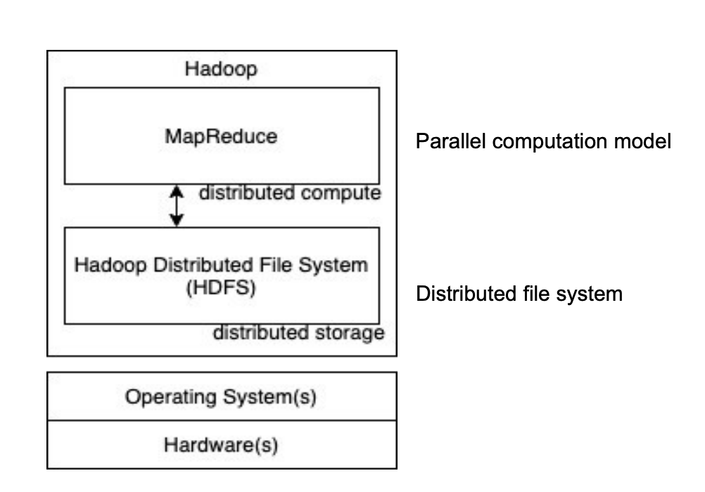
</p>

<p align="center"><em>Figure 1 — Hadoop layered architecture: computation with MapReduce and distributed storage with HDFS (source notes, p. 2).</em></p>

<p align="center">
  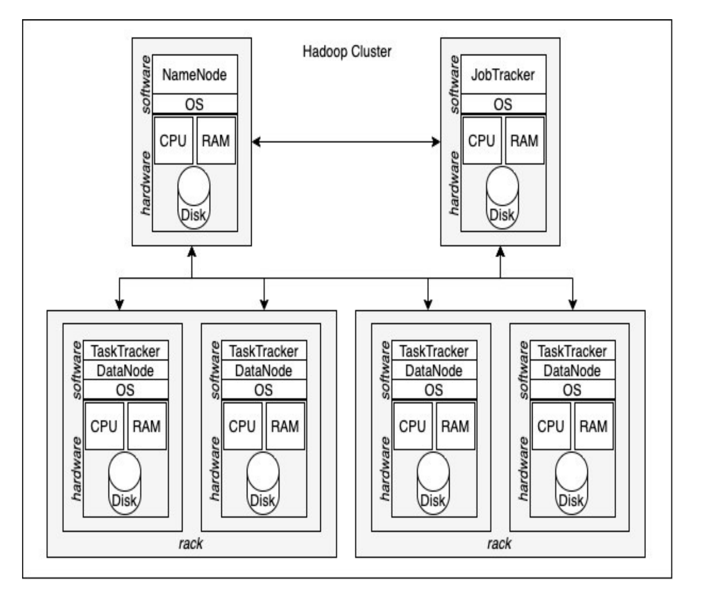
</p>

<p align="center"><em>Figure 2 — A Hadoop cluster combining computation and storage roles (source notes, p. 2).</em></p>

## 3.2 Basic Hadoop terminology

| Term | Meaning in the notes |
|---|---|
| **Commodity hardware** | Off-the-shelf, inexpensive, regular computers rather than large specialized servers. |
| **Node** | A machine / computer / PC in the cluster. |
| **Cluster** | A collection of interconnected computers, potentially arranged in multiple racks. |
| **Rack** | A collection of machines connected through the same switch. |

<p align="center">
  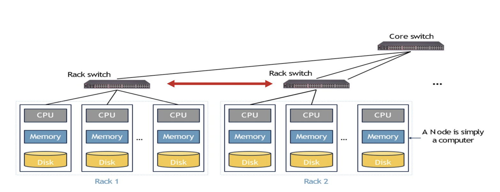
</p>

<p align="center"><em>Figure 3 — Cluster organization using rack switches and a core switch (source notes, p. 3).</em></p>

## 3.3 Main targets of Hadoop

### 1. Storage for very large datasets

- Designed to store terabytes, petabytes, and beyond.
- Scales by distributing data across multiple machines.
- Hardware- and operating-system-agnostic in the framing of the notes.

### 2. Compute on hundreds or thousands of commodity machines

Large-scale processing should not require a small number of expensive servers. Instead, work is distributed across many machines.

### 3. Fault tolerance

Machine failure is treated as a normal event in large-scale systems. Hadoop is designed so that storage and computation can continue when individual machines fail.

### 4. Efficient read access

A common access pattern is scanning large datasets. Hadoop therefore emphasizes high-throughput reading of large amounts of data.

### 5. Efficient append operations

The notes emphasize a **write-once, read-many** style of use:

- Data is usually written once.
- It is read many times.
- Random reads, inserts, updates, and deletes are comparatively uncommon.

---

# 4. HDFS — Hadoop Distributed File System

## 4.1 What is HDFS?

**HDFS (Hadoop Distributed File System)** is the distributed storage layer of Hadoop.

According to the notes, HDFS:

- Stores very large amounts of data of different types and sizes.
- Does not enforce a schema when data is written, supporting a **schema-on-read** style.
- Replicates data automatically to tolerate node failures.
- Uses a NameNode-centered metadata architecture, with a Secondary NameNode / checkpoint-related role discussed later in the notes.
- Is optimized for high-throughput reads and append-oriented workloads.

### Core components

- **NameNode** — master node that manages metadata.
- **DataNodes** — worker nodes that store actual data blocks.

## 4.2 How Hadoop addresses the Big Data dimensions in the notes

### Problem 1 — Volume

**Solution: HDFS**

- Stores data across a cluster of machines.
- Uses a distributed file system.
- Divides files into blocks and distributes those blocks across machines.
- Provides fault tolerance through replication.

### Problem 2 — Variety

**Solution: HDFS**

- Can store many data types.
- Does not require schema validation at write time.
- Works well for write-once, read-many applications.

### Problem 3 — Velocity / processing large data quickly

**Solution: MapReduce**

- Performs parallel processing across multiple machines.
- Separates metadata/job coordination from actual data processing.
- Distributes workload among worker nodes.
- Supports fault-tolerant computation when nodes fail.

## 4.3 HDFS assumptions and design goals

The notes present the following assumptions:

### Hardware failures are common

Large clusters contain many machines, so failures are expected rather than exceptional. HDFS is designed around fault tolerance.

### Very large data is common

The system is intended to store and process datasets ranging from gigabytes to terabytes and beyond.

### Write once, read many

- Data is written once and read repeatedly.
- Reads may be sequential or may consume large portions of files.
- Computations often scan entire files or large file regions.
- Appending is preferred over repeatedly modifying existing data.

### High throughput is prioritized over low latency

The design emphasizes moving large quantities of data efficiently rather than minimizing the response time of every individual transaction.

## 4.4 Problems HDFS is designed to solve

### 1. Storing large data

- Supports files as large as terabytes or more.
- A single file can be stored across multiple machines.

### 2. Scalability

- Can scale to hundreds or thousands of commodity machines.
- Avoids dependence on a few expensive high-end systems.

### 3. Fault tolerance

- Handles machine failure without losing data when replicas remain available.
- Can be deployed across different hardware environments.

### 4. High throughput and parallel access

- Optimized for batch processing.
- Supports efficient high-volume reading.
- Follows a write-once/read-many style.

### 5. Efficient and atomic append-oriented operations

- Supports sequential appends efficiently.
- The notes describe its consistency model as relaxed for distributed use.

## 4.5 Where HDFS is not a good fit

The notes identify three important limitations:

- **Too many small files** — creates high metadata overhead on the NameNode.
- **Frequent random access** — unsuitable when very low-latency lookups are required.
- **Frequent random updates** — HDFS is not designed for continuously modifying arbitrary locations inside files.

## 4.6 Core HDFS storage ideas

### Idea 1 — Blocks

- A file is divided into fixed-size blocks.
- Each block receives an identifier.
- The notes use **64 MB** as the typical block-size example and state that it is configurable.

### Idea 2 — Blocks are distributed

- Blocks are spread across multiple DataNodes.
- Distribution allows parallel access and scalable storage.

### Idea 3 — Blocks are replicated

- A block is copied to multiple machines.
- The notes use a default replication factor of **3**.

### Idea 4 — Central metadata with NameNode and DataNodes

- The NameNode stores file-system metadata.
- DataNodes store file contents as blocks.

## 4.7 Block-size parameter

The **block size** controls how large each chunk of a file is when distributed across machines. It affects parallelism, metadata overhead, storage efficiency, and I/O behavior.

### Advantages of a large block size

- Fewer NameNode interactions.
- Fewer block-management operations and DataNode connections.
- Higher throughput with fewer I/O operations.

### Disadvantages of a large block size

- Less parallelism during reading.
- Potential wasted space for small files, as described in the notes.

### Advantage of a small block size

- Small files can fit into smaller units, reducing the kind of fragmentation described in the notes.

### Disadvantages of a small block size

- More blocks per file.
- More block-management overhead.
- Larger metadata requirements, which may place pressure on NameNode memory.

## 4.8 Read-throughput exercises

### Exercise 1 — One block per machine

Suppose a file has **B blocks**, each stored on a different machine, and each local disk has read throughput **T**.

- Data per machine = block size
- Time per machine = block size / T

Because all machines read in parallel:

$$
\text{Overall Throughput} = \frac{B \times \text{Block Size}}{\text{Block Size}/T} = B \times T
$$

**Result:** overall read throughput is **B × T**.

### Exercise 2 — B blocks across N machines

Suppose a file has **B blocks**, evenly distributed across **N machines**, and each local disk has throughput **T**.

$$
\text{Time per machine} = \frac{(B \times \text{Block Size})/N}{T}
= \frac{B \times \text{Block Size}}{N \times T}
$$

Therefore:

$$
\text{Overall Throughput} = N \times T
$$

**Result:** because the machines read in parallel, aggregate throughput is **N × T**.

## 4.9 Master–slave and share-nothing architecture

The notes describe a cluster in which one machine acts as the **NameNode** and the remaining machines act as **DataNodes**.

### NameNode

- Stores metadata rather than file content.
- Maintains global knowledge of the file system.
- Does not directly transfer file data in the described read path.

### DataNode

- Stores actual file contents in blocks.

<p align="center">
  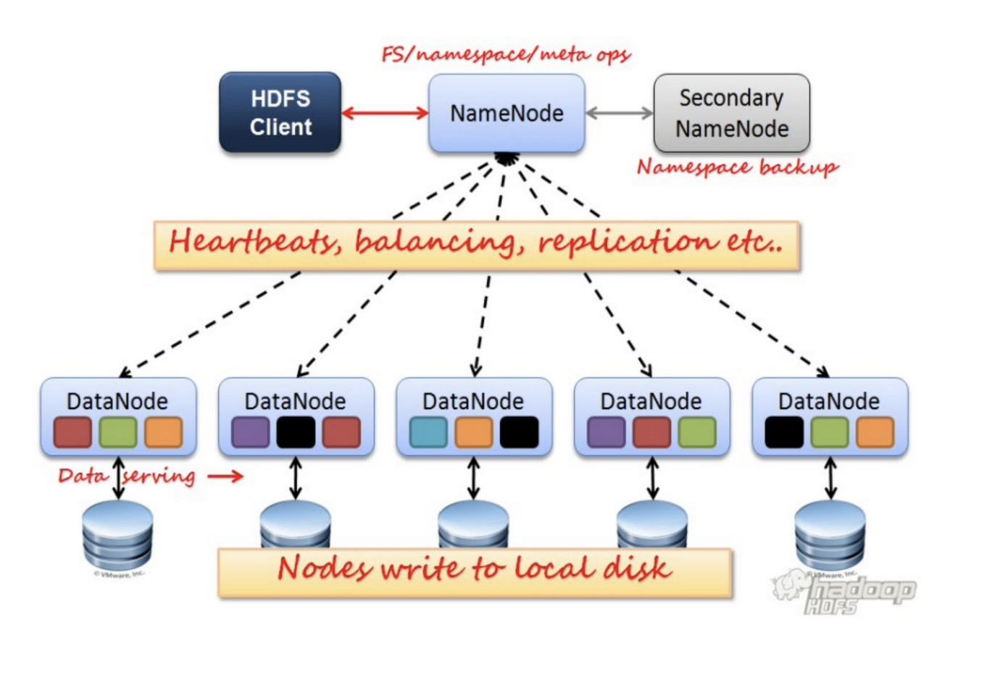
</p>

<p align="center"><em>Figure 4 — HDFS master–worker architecture and the relationship between client, NameNode, Secondary NameNode, and DataNodes (source notes, p. 8).</em></p>

A client can run on a machine in the cluster if enough resources are available. The notes also warn that poorly managed low-reliability applications can contribute to failures.

## 4.10 Client and HDFS interaction

### Steps in file access

1. The client contacts the **NameNode** to request a file.
2. The NameNode returns block IDs and replica locations.
   - The client may cache file/block information temporarily.
   - When the cache expires, the client contacts the NameNode again.
3. The client translates a file name and byte offset into the relevant block ID.
4. The client contacts the required DataNode and requests data using the block ID and offset.
5. Sequential block IDs and locations may be used for additional optimization.

## 4.11 NameNode responsibilities

The notes describe one NameNode per cluster in the Hadoop 1.0-style discussion.

### Coordination with DataNodes

- Receives heartbeats and block reports.
- Coordinates block placement, migration, re-replication, and rebalancing.
- Manages block leases and garbage collection.

### File-system operations

- Creates, renames, and deletes files.
- Assigns block IDs.
- Manages file ownership and permissions.

### Fault tolerance and recovery

- Maintains logs and checkpoints.
- Works with checkpoint/secondary or standby-related mechanisms discussed later in the notes.

### Metadata recorded by the NameNode

Examples include:

- Block locations
- File sizes
- Permissions
- Directory hierarchy
- File-to-block mapping

Two metadata concepts are emphasized:

#### FsImage

Contains the file-system namespace state represented by the NameNode checkpoint image.

#### EditLogs

Contain recent modifications made after the most recent image/checkpoint state.

### NameNode metadata categories

#### File-system namespace

- File names
- Directory hierarchy
- Versions
- File-to-block mapping
- Locks, permissions, and ownership

#### Block namespace

- Lists of blocks forming each file
- Block IDs and versions as described in the notes

#### Replica management

- Tracks replica locations on DataNodes.
- Replica-location information is refreshed from DataNode reports.

## 4.12 DataNode responsibilities

The notes describe typically one DataNode per worker machine.

A DataNode can:

- Create, read, replicate, and delete blocks as instructed.
- Use byte-range offsets during reads.
- Support appending data at the end of files.
- Store and retrieve data for clients.
- Execute storage-management commands from the NameNode.
- Report machine/block health.
- Work with blocks rather than the higher-level file abstraction.
- Store blocks as separate files in the underlying local file system.

## 4.13 Heartbeats and block reports

- A **DataNode sends heartbeats to the NameNode**, not the reverse.
- If heartbeats stop, the NameNode assumes that the DataNode has failed.
- The NameNode then stops directing I/O to that failed node.
- DataNodes periodically report their block lists so that the NameNode maintains a current global view.
- The notes present this periodic reporting as a simple way to stay synchronized as DataNodes join, leave, or fail.

The notes record the heartbeat example as **about 3 seconds** and the full block-report example as **about 6 hours**, illustrating that liveness and full inventory reporting occur at very different frequencies.

## 4.14 Why and where HDFS replicates data

### Why replicate?

- Higher aggregate read throughput
- Fault tolerance
- Protection from data loss and corruption
- High availability

### Where are replicas stored?

The notes use three copies as the common example:

- Copies should be placed on different machines.
- In multi-rack environments, at least one copy should be on a different rack.

<p align="center">
  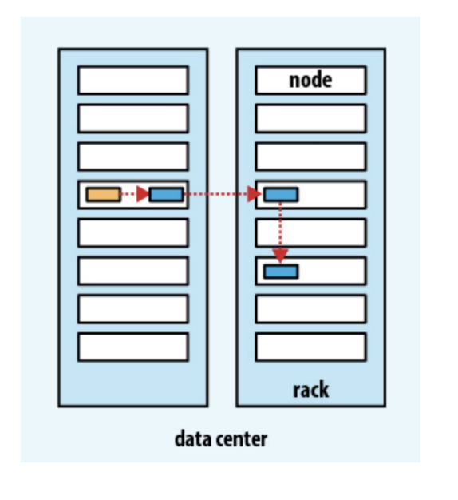
</p>

<p align="center"><em>Figure 5 — Rack/node organization used to motivate rack-aware placement (source notes, p. 11).</em></p>

### Rack-aware placement strategy in the notes

- Replication factor per file: **3** in the worked discussion.
- A DataNode should not store more than one replica of the same block.
- A rack should not store more than two replicas of the same block.

The placement example is:

1. First replica → placed on the initial DataNode.
2. Second replica → placed on another rack, preferably a close one.
3. Third replica → placed on the same remote rack as replica 2, but on another node.

### Placement goals

- **Maximum reliability** — spread replicas so that machine or rack failure does not remove all copies.
- **Network efficiency / data locality** — reduce unnecessary network transfer.
- **Load balancing** — avoid overloading specific nodes or disks.

### Question: Why limit recent block creation on one machine?

The notes explain that too many newly created blocks on one machine can create a hotspot, especially during append-heavy workloads. Distributing creation across nodes helps balance load and avoids bottlenecks.

### Practice problem from the notes

Consider a **10 TB** file stored using **64 MB blocks**, **3-fold replication**, and a cluster of **100 machines**.

- How many blocks is the file split into?
- How much disk space is required overall?
- How much disk space does the file consume per machine if the replicas are evenly distributed?

## 4.15 Downsides of replication

- More expensive to create/write a file because multiple copies are produced.
- Modifying a replicated file is more complicated.
- More raw disk capacity is required.

## 4.16 Failure handling

### 1. Hardware failure

A general failure in storage, machine, or network infrastructure.

### 2. Block failure

- The DataNode detects a problem and informs the NameNode.
- The NameNode creates another copy of the affected block elsewhere.
- Failed or unusable blocks can later be garbage-collected.

### 3. DataNode failure

- The NameNode detects the failure when heartbeat messages stop.
- Blocks on the failed node may need new replicas.
- The NameNode coordinates re-replication to restore the configured replication factor.

### Probability questions from the notes

1. A file has **k blocks**, all stored locally on one machine. Machine-failure probability is **p**. What is the probability that the file is lost?
2. A file has **k blocks**, each stored on a different machine. Each machine has failure probability **p**. What is the probability that the file is lost?
3. A file has **k blocks** with **3 replicas** distributed across machines. Given machine-failure probability **p**, what is the probability of file loss?

These are preserved as study questions because the original notes present them without a worked solution.

## 4.17 Rebalancing

**Rebalancing** is a periodic process that evaluates cluster nodes and adjusts replica placement.

It can involve:

- Creating replicas
- Re-creating missing replicas
- Moving replicas

### Objectives

- Improve cluster performance.
- Improve disk-space utilization.
- Avoid situations where some nodes handle too many requests while others are underused.
- Place frequently accessed blocks closer to computation when possible, as described in the notes.

## 4.18 Garbage collection

Garbage collection removes unnecessary blocks from distributed storage.

Blocks described as candidates in the notes include:

- Stale / outdated blocks
- Inconsistent blocks
- Corrupted blocks
- Orphaned blocks that no longer belong to a file

### Lazy deletion strategy in the notes

- A configurable waiting period may be used before permanent deletion; the notes give **3 days** as the default example.
- Deleted data can first be hidden rather than immediately destroyed.
- This creates an opportunity to recover accidental deletions.
- Final removal may be scheduled when NameNode load is lower.
- Blocks continue to consume space until permanent deletion occurs.
- The notes describe data removal occurring before the corresponding metadata cleanup is finalized.

## 4.19 Data integrity

Data integrity ensures that stored or transmitted data is not corrupted by hardware problems or transmission errors.

The notes describe two mechanisms:

- **Checksums**
- **Block versioning**

### Checksum workflow described in the notes

At file creation/modification:

- The notes state that checksum information is generated/tracked when data is created or modified.
- They describe the NameNode as tracking expected checksum information and hidden checksum files as residing with block data on DataNodes.

Before / during transfer:

- A DataNode calculates a checksum for outgoing data.
- The checksum is compared with the expected value.
- A mismatch indicates corruption.

Client-side verification:

- The client verifies received data.
- If verification fails, it can request another replica.

### Block versions in the notes

- A block has a version number tracked by metadata.
- If a disconnected DataNode later reconnects with a stale replica, version information can be used to distinguish current and outdated data.

## 4.20 Logs

Logs are presented as a way to preserve consistency by recording file-system changes before those changes are fully incorporated into persistent namespace state.

Why use logs?

- Writing every small metadata change as a complete new state is inefficient.
- Changes can be recorded incrementally and handled in batches.

The notes describe a workflow in which:

- Changes are first recorded in memory / a log buffer.
- Logs are stored locally on the NameNode disk.
- Logs can be copied to a remote backup or standby system for fault tolerance.

## 4.21 Checkpoints

A **checkpoint** periodically saves the current NameNode metadata state.

### Why checkpoints are needed

- NameNode recovery
- Preventing unbounded log growth
- Efficient state restoration / metadata management

### Checkpoint process in the notes

1. New edit activity is redirected to a new log file before checkpoint creation.
2. Checkpoint work may run on a separate thread or dedicated checkpoint node.
3. Checkpoint data can be stored locally and remotely.
4. Pending changes are accounted for before finalizing the checkpoint.

Older checkpoints may be deleted or analyzed, while recent checkpoints may be kept for disaster recovery.

<p align="center">
  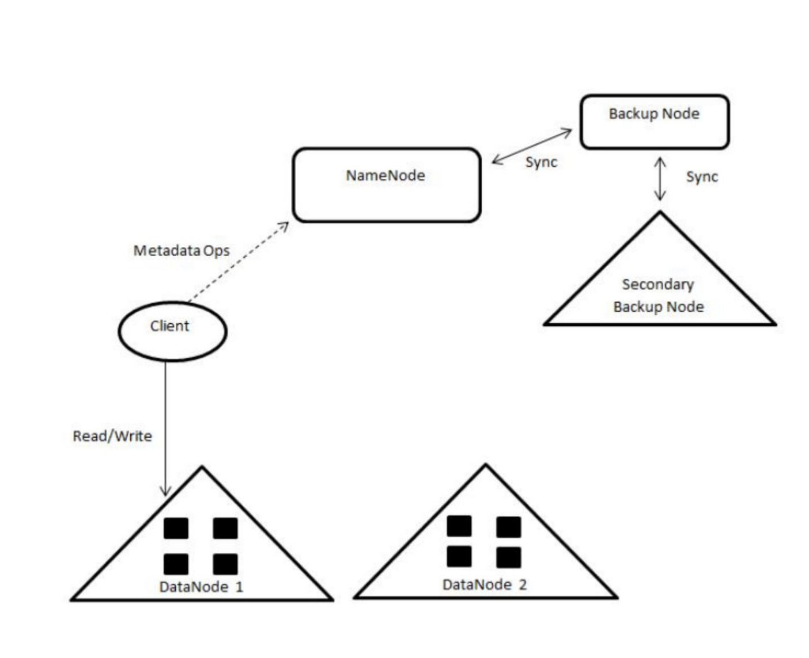
</p>

<p align="center"><em>Figure 6 — NameNode replication / backup strategies shown in the source notes (p. 16).</em></p>

## 4.22 Backup and standby nodes

### Backup node

- Stores periodic backups of NameNode state.
- Helps recover metadata after a failure.

### Standby node

- Mirrors the active NameNode state in real time in the notes' high-availability discussion.
- Supports faster recovery and reduced downtime.

## 4.23 NameNode scalability and HDFS Federation

A single NameNode may become a metadata bottleneck in a very large cluster. The notes introduce **HDFS Federation** as a way to scale metadata horizontally.

### Federation model

- Multiple independent NameNodes are used.
- Each NameNode manages a different portion of the namespace.
- DataNodes are shared and can serve blocks associated with multiple NameNodes.

### Benefits listed in the notes

- Scalability
- Increased throughput
- Fault isolation
- Better load balancing

<p align="center">
  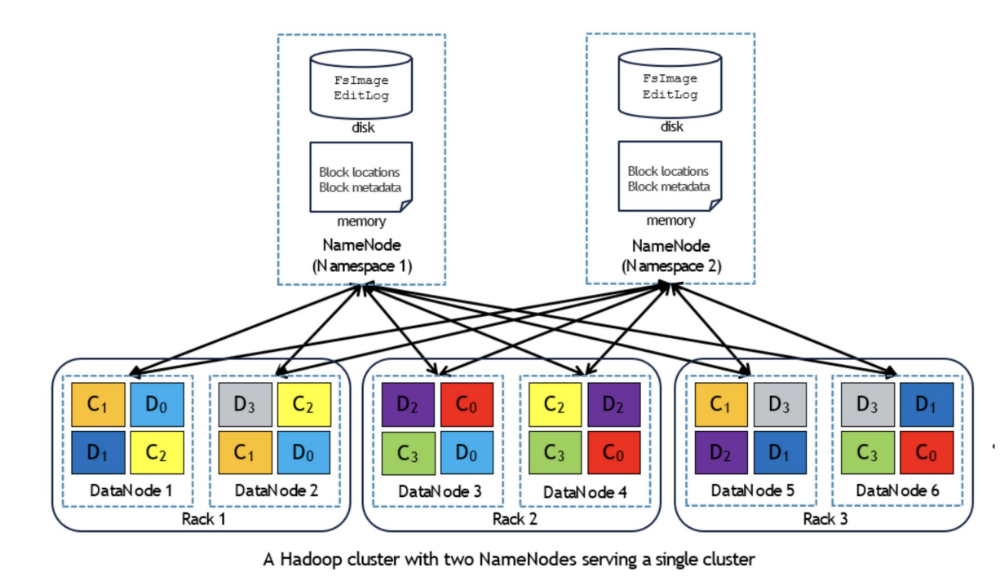
</p>

<p align="center"><em>Figure 7 — HDFS Federation with multiple NameNodes serving one DataNode pool (source notes, p. 17).</em></p>

## 4.24 HDFS file-read process

1. The client asks the NameNode for the block locations of the requested file.
2. The client chooses a DataNode for each block.
   - Prefer local data when available.
   - Otherwise prefer a nearby DataNode, such as one in the same rack.
3. The client contacts DataNodes directly to transfer data.
4. If a DataNode fails, the client retries or contacts another replica.

<p align="center">
  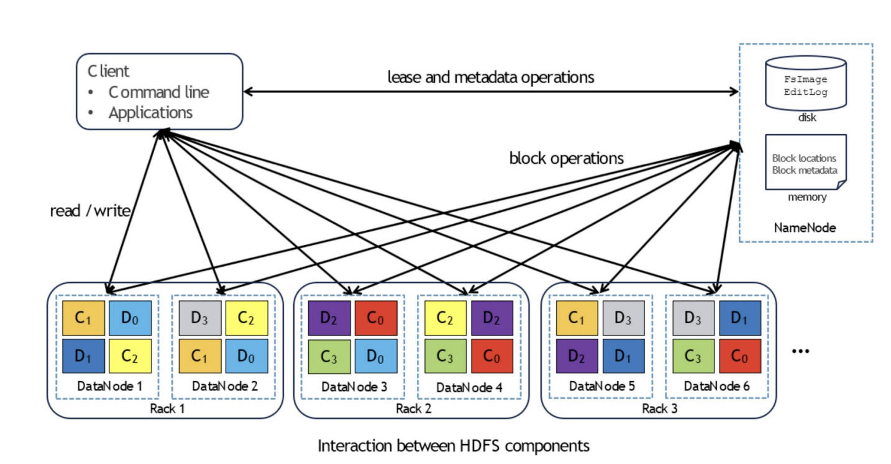
</p>

<p align="center"><em>Figure 8 — Client metadata operations with the NameNode and direct block I/O with DataNodes (source notes, p. 18).</em></p>

## 4.25 HDFS file-write pipeline

The notes describe a three-replica pipeline:

1. The client sends data to the first DataNode / primary replica.
2. The first DataNode forwards data to the second replica.
3. The second DataNode forwards data to the third replica.
4. After replicas receive the data, the write is committed in the pipeline.
5. An acknowledgement is returned toward the client.

<p align="center">
  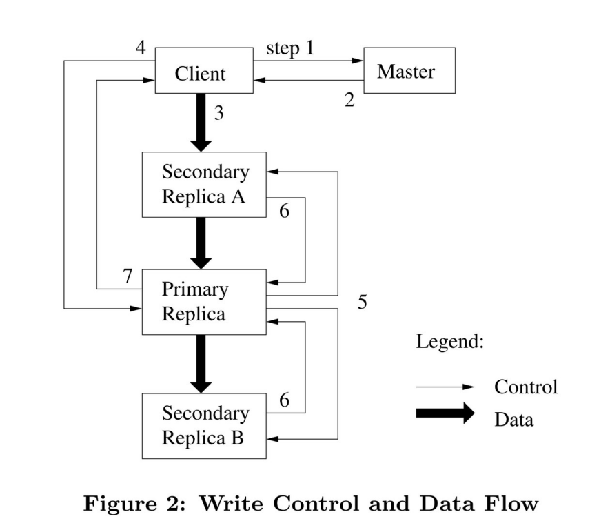
</p>

<p align="center"><em>Figure 9 — Write control and data flow among client and replicas (source notes, p. 19).</em></p>

## 4.26 Block lease

A **block lease** is described as temporary ownership granted by the NameNode to a primary replica, allowing that replica to coordinate writes or modifications to the block.

## 4.27 Caching

- Cached metadata has an expiration period to reduce cache-coherence problems.
- The notes state that some DataNode-level caching can be handled by the operating system.

## 4.28 RPC, HTTP, and TCP in HDFS

### RPC

HDFS uses **Remote Procedure Calls (RPC)** for many control and metadata interactions.

The notes describe RPC as a request-response mechanism in which one node sends a request and another node responds.

### HTTP

An HTTP-based web interface can be used by administrators to monitor:

- Cluster health
- Active nodes
- Failed nodes
- Replication status

An example address in the notes is:

```text
http://namenode-address:50070
```

The key point in the notes is that HTTP is used for **monitoring/status**, not for the main bulk block-transfer path.

### TCP

The notes identify **TCP** as the reliable transport used for data transfer between clients and DataNodes.

They also state that the NameNode does not initiate RPC requests in the interaction model being discussed.

The notes further emphasize that HDFS exposes multiple interfaces so different users and applications can interact with the system in different ways.

## 4.29 HDFS diagnostic tools

Diagnostic tools are used for:

- Debugging
- Performance analysis

---

# 5. From Sequential Processing to Distributed Computing

The notes motivate MapReduce by comparing three approaches to a large word-count style workload.

## 5.1 Sequential processing

### Pros

- Simple to implement.
- Requires little extra memory.

### Cons

- Slow for a very large file such as the **32 GB** example in the notes.
- Single-threaded execution cannot use multiple CPU cores effectively.
- Reading and writing the whole file sequentially creates substantial I/O overhead.

## 5.2 Parallel multithreaded / multicore processing

### Pros

- Faster because multiple CPU cores can work at the same time.
- Multiple lines or partitions can be processed concurrently.

### Cons

- Shared state requires synchronization.
- A global word-count map can suffer race conditions.
- More complex than sequential processing.

## 5.3 Multithreaded solution 1 — one global map

### Pros

- Counting work happens in parallel.
- A single map reduces final merge work.

### Cons

- Multiple threads can update the same word simultaneously.
- Locks or atomic operations are needed.
- Frequent synchronization can reduce performance.

## 5.4 Multithreaded solution 2 — one map per thread, then merge

### Pros

- Each thread maintains its own local map.
- Race conditions during counting are avoided.
- No lock is required for every update.
- The notes characterize the final merge as cheaper than constant synchronization.

### Cons

- A merge step is required at the end.
- More memory is required for multiple maps.

## 5.5 Which approach fits which data size?

| Data size / situation | Approach emphasized in the notes |
|---|---|
| Small files | Sequential processing |
| Medium files | Multithreaded processing with one map per thread + merge |
| Very large / Big Data | Distributed processing using MapReduce or Spark |

---

# 6. MapReduce

## 6.1 What is MapReduce?

**MapReduce** is a programming model for large-scale data processing. It divides a large computation into smaller tasks that can run in parallel across machines in a Hadoop cluster.

A central idea is:

> **Move computation to the data instead of moving large datasets across the network.**

The notes present MapReduce as a divide-and-conquer model:

- **Map phase** — processes smaller pieces of input in parallel.
- **Reduce phase** — combines / aggregates intermediate results.

### Advantages listed in the notes

- Scalable
- Fault-tolerant
- Load-balanced
- Relatively easy to program within the model
- Suitable for batch processing

## 6.2 How MapReduce works conceptually

### 1. Divide a task into subtasks

A large input, such as the **32 GB** example, is divided into smaller pieces.

### 2. Run subtasks in parallel

- Each piece is processed by a mapper.
- Mappers can run on different machines.
- Reducers aggregate mapper outputs.

### 3. Communicate intermediate results

- Intermediate key-value pairs are shuffled between map and reduce stages.
- Data is grouped and sorted by key before reduction.

### 4. Recover from failures

- HDFS replication protects source data.
- Failed tasks can be executed again on another node.

## 6.3 Basic MapReduce dataflow

1. **Input splitting** — divide a large input file into smaller pieces.
2. **Map** — transform each piece into intermediate key-value pairs.
3. **Shuffle and sort** — group related keys and move data to the appropriate reducer.
4. **Reduce** — aggregate values and write final results to HDFS.

<p align="center">
  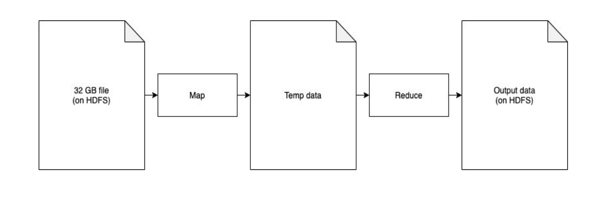
</p>

<p align="center"><em>Figure 10 — Basic MapReduce flow from input through Map and Reduce to output (source notes, p. 23).</em></p>

<p align="center">
  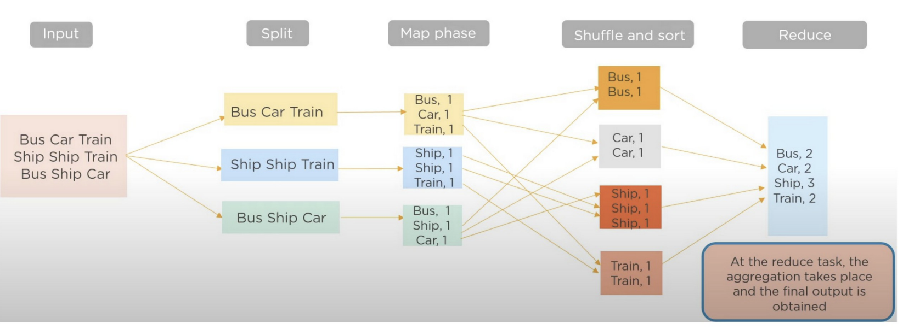
</p>

<p align="center"><em>Figure 11 — Example of splitting, mapping, shuffling/sorting, and reducing word-like records (source notes, p. 23).</em></p>

## 6.4 How a MapReduce job is submitted

A client submits a job consisting of:

- Input file(s)
- A MapReduce program, commonly packaged as a JAR in the Hadoop 1.x discussion

The system then:

- Starts tasks, each in its own JVM/process in the notes' architecture.
- Uses JobTracker / TaskTracker concepts in the Hadoop 1.0 discussion.
- Distributes tasks.
- Tracks status and failures.

## 6.5 Input splits

An input file is divided into logical **input splits** based on file size, HDFS block size, and the selected input format.

The notes describe a split as a logical unit in which:

- The key can represent an offset in the file.
- The value represents the associated record/data.

Example: a **32 GB** input in HDFS is divided into blocks stored across DataNodes.

## 6.6 Map phase

- A map task receives an input `(key, value)` pair.
- It emits zero or more intermediate `(key, value)` pairs.
- Map functions run in parallel on different input splits.

## 6.7 Shuffle phase

- Intermediate key-value pairs are transferred from mappers toward reducers.
- Records with the same key are grouped together.
- The notes emphasize that this stage can generate heavy network traffic.

## 6.8 Reduce phase

- A reducer receives a key and a collection / iterator of values.
- It aggregates or transforms those values into final output.

<p align="center">
  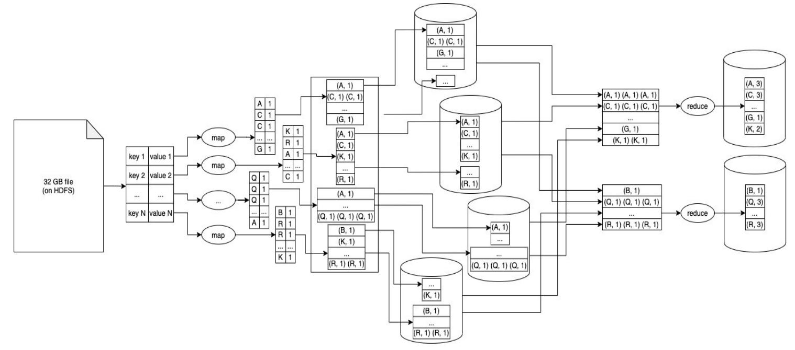
</p>

<p align="center"><em>Figure 12 — Detailed MapReduce workflow from input through map-side processing, shuffle, and reduce-side output (source notes, p. 24).</em></p>

## 6.9 MapReduce as two major processing stages

The notes describe MapReduce as two large stages—**Mapper** and **Reducer**—with several internal steps.

### Stage 1 — Read / preprocessing

- **Input Split** — divides the large input into logical chunks.
- **InputFormat** and **RecordReader** — define how raw input is converted into records such as line-oriented key-value pairs.

### Stage 2 — Mapper side

- **Map** — converts input records into intermediate key-value pairs.
- **Group, Sort, Partition** — organizes keys and assigns records to reducers.
- **Write to local disk** — intermediate mapper output is temporary and stored locally before shuffle.

### Stage 3 — Reducer side

- **Shuffle and Merge** — retrieves partitions from mappers, combines them, and maintains key ordering.
- **Reduce** — processes grouped values.
- **Write to HDFS** — persists final results.

## 6.10 How blocks are distributed and read into memory

The notes use this worked structure:

1. A **32 GB** file is divided into **512 blocks** of **64 MB** each.
2. Blocks are stored across multiple DataNodes.
3. Replicas are distributed across machines/racks for fault tolerance and availability.
4. When processing begins, HDFS fetches the needed blocks.
5. Data is loaded into memory for computation.

<p align="center">
  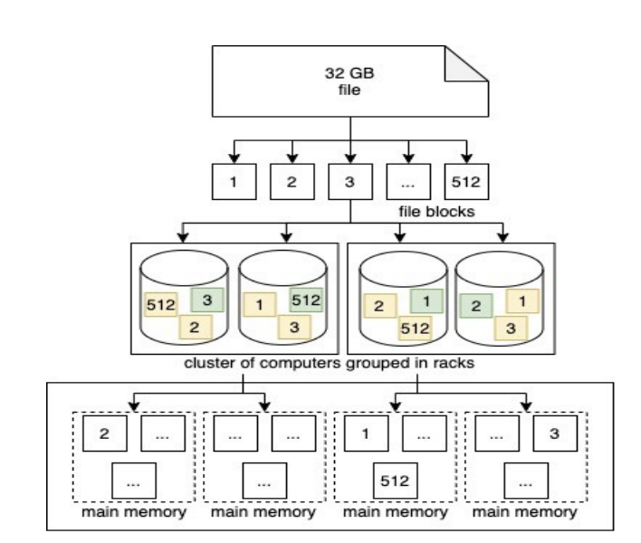
</p>

<p align="center"><em>Figure 13 — HDFS blocks distributed across a cluster and read into machine memory (source notes, p. 25).</em></p>

<p align="center">
  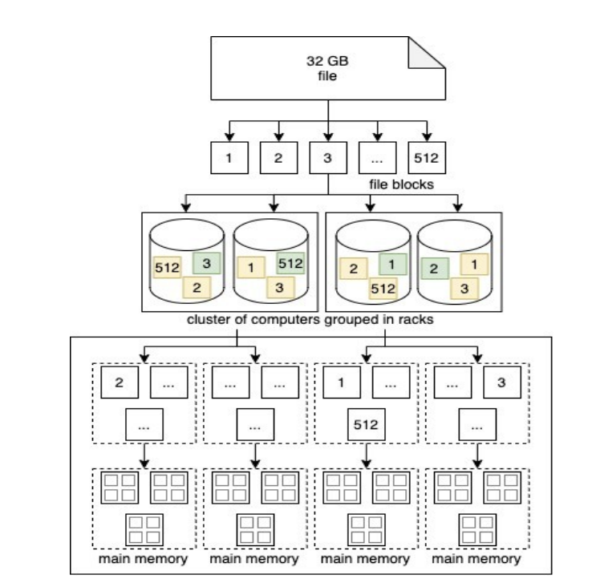
</p>

<p align="center"><em>Figure 14 — Block distribution across racks and execution context for MapReduce (source notes, p. 26).</em></p>

## 6.11 Block splits, InputFormat, and RecordReader

- Large files are divided into blocks/splits.
- The notes use the file offset as an example key and split content as the value.
- **InputFormat** determines how data is logically split.
- **RecordReader** converts raw bytes into structured records that the mapper can process.

## 6.12 Split-size considerations

### When split size equals block size

No additional logical split across multiple blocks is required in the simplified example.

### When split size differs from block size

An input split can involve data spanning block boundaries.

### Advantages of smaller splits

- Work can be distributed more evenly.
- Faster machines can process more tasks.
- A failure may require reprocessing a smaller amount of data.

### Disadvantages of smaller splits

- More tasks must be created and managed.
- Task startup and teardown add overhead.

### Advantages of larger splits

- Fewer tasks to create and schedule.
- Less scheduling overhead.
- Less context switching.
- Potentially better sequential disk I/O.

### Disadvantages of larger splits

- Fewer tasks can run in parallel.
- Cluster resources may be underutilized.
- A failed large task takes longer to rerun.
- Work may be unbalanced if some tasks are much larger than others.
- One long-running task can delay completion.

## 6.13 Data locality

A key Hadoop principle in the notes is:

> **Move computation to data.**

- If a task runs on the node that stores the required block, network traffic is minimized.
- If the data is remote, it must be transferred over the network, increasing latency.

## 6.14 Assigning splits to map tasks

- Each split is assigned to a map task.
- Prefer the same node that stores the data.
- If that node lacks compute resources, prefer another node in the same rack.

<p align="center">
  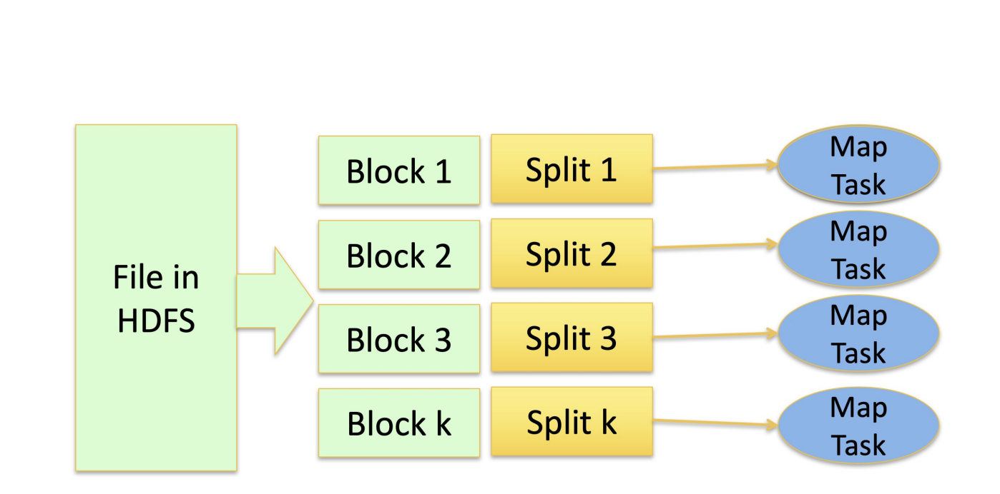
</p>

<p align="center"><em>Figure 15 — HDFS blocks, logical splits, and corresponding map tasks (source notes, p. 28).</em></p>

<p align="center">
  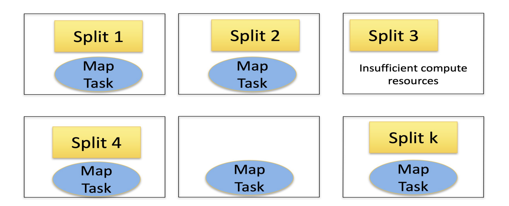
</p>

<p align="center"><em>Figure 16 — A locality case in which the preferred machine has insufficient compute resources (source notes, p. 28).</em></p>

<p align="center">
  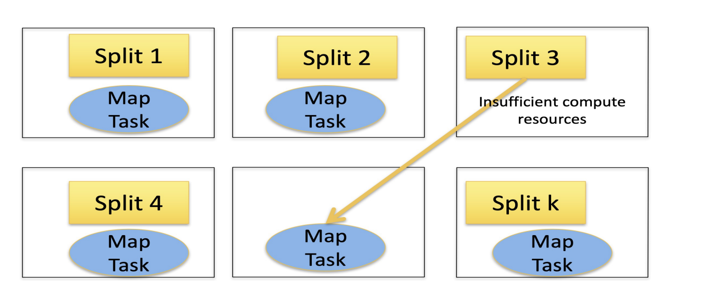
</p>

<p align="center"><em>Figure 17 — Fallback placement of a map task when the local node cannot run it (source notes, p. 28).</em></p>

## 6.15 Group, sort, and partition

### GroupBy

Groups intermediate values by key before the reducer sees them. The notes describe local aggregation/grouping as a way to reduce unnecessary data movement. Up to this local mapper-side stage, the notes emphasize that the intermediate processing can remain on the same machine without network transfer.

### Sort

Orders keys so reducer input arrives in an organized sequence.

### Partition

Assigns records to reducer partitions. If there are **R reducers**, mapper output is logically separated into **R partitions**.

## 6.16 What if intermediate data does not fit in RAM?

The notes introduce **spilled intermediate data**.

Example: if a mapper-side hash map reaches about **200 MB** in the worked explanation, data can be spilled to local disk.

Each spill undergoes:

1. Grouping by key
2. Local sorting by key
3. Partitioning into **R** files / sections, one for each reducer

After multiple spills are created, corresponding sorted partitions are merged before or during the shuffle preparation process.

## 6.17 Shuffle

- Reducer-side logic fetches partitions produced by multiple map tasks.
- Network traffic carries mapper output to the proper reducer.
- Multithreaded fetching can retrieve data from different mappers concurrently.

## 6.18 Merge

- Partitions from multiple mappers are merged.
- Key order is maintained for reducer processing.
- Fetching can continue while merge work occurs.
- If data does not fit in memory, disk-based merging is used.
- Intermediate merged runs may be spilled back to disk.

### Multi-round multi-way merge example

Suppose there are **12 sorted partitions**, but memory can merge only **4 partitions at a time**.

- **Round 1:** merge 4 at a time → 3 intermediate merged files.
- **Round 2:** merge those 3 files → 1 final merged file.

This limits the amount of data handled in memory at once and prepares ordered reducer input.

## 6.19 Reduce

- Input is a **key** and an iterator/list of associated values.
- The reduce method processes keys in sorted order.
- Values can be aggregated, such as summing word counts.
- Final output is written to HDFS.

## 6.20 Map, Reduce, and complete MapReduce step summaries

### Map task — four phases in the notes

1. **Map** — process input key-value pairs and emit intermediate pairs.
2. **Group** — gather intermediate values by key.
3. **Sort** — order intermediate keys.
4. **Partition** — divide intermediate data into one partition per reducer.

### Reduce task — three phases

1. **Shuffle** — fetch mapper partitions.
2. **Merge** — combine sorted partitions.
3. **Reduce** — process keys and associated values.

### Complete flow

- Map reads input splits and emits key-value pairs.
- Grouping and sorting organize values by key.
- Reduce aggregates or transforms them.
- Final output is written to HDFS.

## 6.21 Stages in executing a MapReduce job

1. Client submits the job and its functions/input.
2. The system assigns map and reduce tasks.
3. The client/configuration specifies the number of reducers.
4. Map tasks process input and produce intermediate data.
5. Intermediate data is shuffled over the network.
6. Reduce tasks produce final output.
7. The system reports completion/results to the client.

## 6.22 Why group and sort?

### Why group?

Grouping ensures that all values for a key are available together before reduction.

### Why sort?

Sorting arranges keys in a predictable order so reducers can process them sequentially.

### What is gained?

The notes connect grouping/sorting with:

- More organized reducer input
- Efficient sequential processing
- Lower reducer-side organization overhead
- Reduced unnecessary movement when local aggregation is possible

### Why not wait until the reducer to organize everything?

The notes explain that mapper-side organization distributes the work while each mapper handles only a portion of the data. Deferring all organization until later would concentrate more work at the reduce side.

### Why not sort after reduction?

The notes state that the data is already aggregated after reduction, so an additional sorting step is not required for the workflow being discussed.

### Why not store intermediate data in HDFS?

Intermediate mapper output is temporary. Writing it to HDFS would add:

- Extra disk I/O
- Extra latency
- Extra storage overhead

Therefore, temporary map output is kept on local disk / memory instead.

## 6.23 How many reducers should be used?

The notes state that reducer count depends on:

- Dataset size
- Cluster resources
- Desired parallelism
- Balance among partitions

Too few reducers can create bottlenecks. Too many reducers add task-management overhead. The notes give a rule-of-thumb example of roughly **1–2 times the number of nodes**, while emphasizing that the correct value depends on workload and cluster conditions.

## 6.24 Hadoop 1.0 MapReduce components

### TaskTracker

- Runs on worker nodes, usually alongside DataNodes.
- One TaskTracker is associated with a worker machine in the notes' Hadoop 1.x model.
- Manages task execution using CPU and memory resources.
- Receives tasks from the JobTracker.
- Reports progress and status.
- Runs as a long-lived process handling many jobs over time.

### JobTracker

- Coordinates overall job execution.
- Stores metadata about map and reduce tasks.
- Tracks task state: idle, in progress, complete.
- Tracks worker-machine information.
- Tracks the location and size of mapper intermediate files.
- Coordinates task assignment and scheduling.

If there are:

- **M map tasks**, and
- **R reduce tasks**,

then the notes describe up to **M × R** mapper-to-reducer partition relationships / intermediate pieces.

<p align="center">
  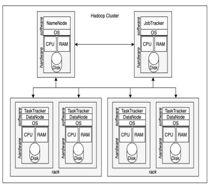
</p>

<p align="center"><em>Figure 18 — Hadoop 1.x-style JobTracker / TaskTracker architecture (source notes, p. 32).</em></p>

## 6.25 What a TaskTracker does during a job

- Prepares the required resources such as the JAR, data references, and dependencies.
- Launches a JVM to isolate the task.
- Reads the assigned input split.
- Executes a mapper or reducer depending on the assigned task.
- Writes intermediate output to local disk.
- Writes final reduce output to HDFS.
- Reports progress to the JobTracker.

The notes highlight process isolation: failure of user code should not necessarily crash the entire worker node.

## 6.26 MapReduce parallelization

- Different map tasks run in parallel.
- Different reduce tasks can also run in parallel.
- Hadoop handles the parallel scheduling automatically.
- In the notes' stage model, reduce computation waits for mapper completion.
- **Shuffle can begin as mapper outputs become available**, so data transfer can overlap with remaining map work.

## 6.27 JobTracker failure

According to the notes:

- A JobTracker failure stops running jobs in the Hadoop 1.x architecture.
- Recovery may use checkpointed metadata/job state if available.
- If recovery is not possible, jobs are aborted and submitted again.

## 6.28 TaskTracker failure

- JobTracker detects failure when heartbeats stop.
- Tasks assigned to the failed node are rescheduled.
- Completed mapper output on the failed node may need to be regenerated because intermediate data is stored locally.
- Completed reducer output is safer because final output is stored in HDFS.
- Reducers are informed of updated mapper-output locations.
- A repeatedly failing node may be blacklisted.

## 6.29 Failure of a map or reduce task

- JobTracker detects missing progress for a task.
- The failed task is scheduled on another worker.
- Backup copies of slow tasks may be launched to reduce completion delays.

## 6.30 Causes of MapReduce latency

- Different processors, disks, memory sizes, or network links may have different speeds.
- Jobs may compete for shared cluster resources.
- Failed tasks must be restarted.
- A small number of slow tasks can delay an otherwise finished job.

## 6.31 Speculative execution / backup runs

The notes describe **speculative execution** as follows:

1. Detect a task running much more slowly than its peers.
2. Launch a duplicate copy on another available node.
3. Run original and duplicate simultaneously.
4. Keep the result from whichever finishes first.
5. Discard the slower copy.

Goal: prevent one slow task from delaying the complete job.

## 6.32 What MapReduce hides from the programmer

The framework can handle much of the following automatically:

- Number of processors used
- Starting remote processes / procedure calls
- Scheduling map and reduce tasks
- Load balancing
- Input splitting and partitioning
- Node failure and task re-execution
- Backup/speculative execution
- Communication and I/O transfers

## 6.33 MapReduce positives

The notes emphasize:

- Useful for real-world batch workloads.
- Hides many distributed-systems details from the application programmer.
- Provides parallel and distributed execution.
- Has a structured programming model.
- Integrates naturally with distributed storage such as HDFS.

## 6.34 Where MapReduce is not a good fit

- Small datasets where distributed overhead dominates.
- Low-latency jobs.
- Rapidly changing data.
- Index-based queries that need a small record immediately.
- Iterative workloads that repeatedly reuse intermediate results.

## 6.35 Hadoop positives summarized

- Distributed data storage
- Parallel computation
- Fault tolerance
- Task and I/O scheduling

---

# 7. YARN

## 7.1 What is YARN?

**YARN — Yet Another Resource Negotiator** — is the general-purpose resource-management layer introduced in the Hadoop 2.0 discussion.

The notes describe YARN as:

- A resource manager for distributed applications.
- Responsible for efficient and flexible resource allocation and scheduling.
- Separate from the specific application execution model.
- Able to support multiple frameworks such as MapReduce, Hive, HBase, and Spark.
- An application/framework-agnostic layer operating with HDFS underneath.

## 7.2 Hadoop 1.0 vs Hadoop 2.0 components

### Hadoop 1.0

- NameNode
- Secondary NameNode / checkpoint role
- DataNodes
- JobTracker
- TaskTrackers

### Hadoop 2.0

- NameNode
- Secondary / checkpoint-related NameNode role
- DataNodes
- **ResourceManager (YARN)**
  - Scheduler
  - Application-management functionality
- **NodeManagers**
- **ApplicationMasters**
- **Containers**

<p align="center">
  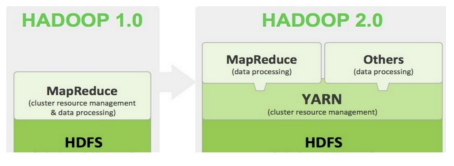
</p>

<p align="center"><em>Figure 19 — Hadoop 1.0 versus Hadoop 2.0 stack in the source notes (p. 35).</em></p>

<p align="center">
  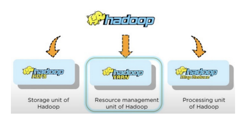
</p>

<p align="center"><em>Figure 20 — Hadoop separated into storage, resource-management, and processing units (source notes, p. 36).</em></p>

## 7.3 YARN vs. Hadoop 1.0 MapReduce resource management

| YARN / Hadoop 2.0 | Hadoop 1.0 MapReduce |
|---|---|
| Primarily separates resource management from application execution | JobTracker combines resource management and program execution responsibilities |
| Supports multiple application frameworks | Focused on the MapReduce programming model |
| Designed for greater scalability | More centralized MapReduce-specific architecture |

## 7.4 JobTracker and TaskTracker limitations in Hadoop 1.0

### JobTracker

Handles:

- Resource allocation
- Scheduling
- Coordination
- Monitoring

### TaskTracker

Executes map or reduce tasks.

### Limitations listed in the notes

- Designed specifically around MapReduce jobs.
- Fixed map/reduce slots can lead to inefficient utilization.
- Some execution slots can remain idle.
- JobTracker failure can disrupt running work.

<p align="center">
  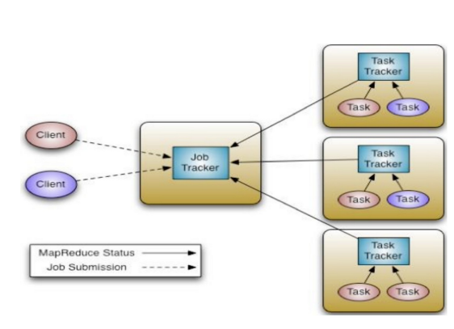
</p>

<p align="center"><em>Figure 21 — Hadoop 1.x JobTracker / TaskTracker execution flow (source notes, p. 37).</em></p>

## 7.5 YARN core components

The notes list:

- **ResourceManager (RM)**
- **NodeManagers (NM)**
- **ApplicationMaster (AM)**
- **Containers**

MapReduce becomes one application model that can run through YARN rather than being the only scheduling model.

## 7.6 ResourceManager (RM)

The ResourceManager provides a global view of cluster compute resources.

### Responsibilities

- Coordinate allocation of compute resources.
- Receive application resource requests.
- Schedule and assign resources.
- Arbitrate resources among competing applications.

### Components described in the notes

#### Application-management function

- Maintains submitted applications.
- Accepts jobs/applications.
- Allocates an initial container for an ApplicationMaster.
- Helps recover failed ApplicationMaster containers.

#### Scheduler

- Allocates cluster resources.
- Does not directly track application task progress in the notes' separation of responsibilities.

### Characteristics

- Centralized global resource-management role.
- One logical ResourceManager per cluster in the basic model.
- Backup/standby mechanisms can support recovery.
- Designed to scale to large workloads.
- Direct task-level execution monitoring is separated from the central scheduler; the notes refer to the **Job History Server** for separate job/task history tracking.

<p align="center">
  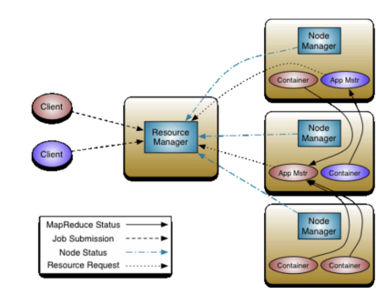
</p>

<p align="center"><em>Figure 22 — YARN ResourceManager coordinating NodeManagers (source notes, p. 38).</em></p>

## 7.7 Application Manager / application-management role

The notes distinguish application-management responsibilities that include:

- Accepting applications submitted to YARN.
- Negotiating or allocating the initial resources needed to launch an ApplicationMaster.
- Allocating the first container for the application-specific AM.
- Handling failure/restart of ApplicationMaster containers.

## 7.8 NodeManager (NM)

A NodeManager:

- Runs on each worker machine.
- Is commonly colocated with a DataNode.
- Manages local compute resources such as CPU and RAM.
- Monitors local resource use.
- Reports resource status to the ResourceManager.
- Registers with the ResourceManager at startup.
- Sends heartbeats.
- Launches and stops containers.
- Responds to requests from ApplicationMasters.

## 7.9 Container

A **container** represents a bundle of compute resources on a worker machine.

The notes describe containers in terms of:

- Virtual CPU allocation
- RAM allocation
- A unique container ID

Tasks run inside containers. NodeManagers create/stop containers, while the ResourceManager schedules the resource allocation.

## 7.10 ApplicationMaster (AM)

An ApplicationMaster runs **per application** in a container on a worker node.

### Responsibilities in the notes

- Estimate resource needs for tasks.
- Decide the number and desired location of tasks.
- Consider data-locality preferences.
- Request more or fewer resources as needed.
- Negotiate container allocations with the ResourceManager.
- Coordinate tasks within one application/job.
- Monitor job/task progress.
- Register with the ResourceManager.
- Send heartbeats / status updates.
- Ask NodeManagers to start tasks in allocated containers.
- Release containers when work completes.
- Receive information about terminated containers.

## 7.11 Steps in YARN application execution

1. An application contacts the ResourceManager.
2. The RM allocates a container for the application's ApplicationMaster.
3. The AM starts and registers with the RM.
4. The AM requests additional containers.
5. If resources are granted, the AM contacts the relevant NodeManagers.
6. NodeManagers launch containers and application tasks run inside them.
7. Tasks communicate status to the AM.
8. When tasks finish, containers are released and the AM exits.
9. The application client completes/exits.

<p align="center">
  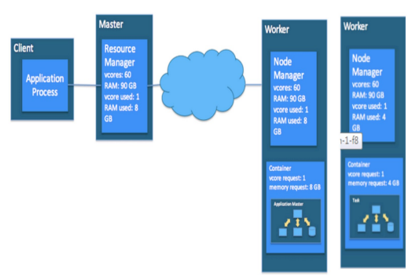
</p>

<p align="center"><em>Figure 23 — YARN application execution across client, master, and worker roles (source notes, p. 40).</em></p>

## 7.12 Error detection in YARN

### ApplicationMaster failure

- The notes state that missing task-progress updates can be reported so work is rescheduled.
- The ResourceManager can detect missing AM heartbeats.
- Tasks or the AM can be rescheduled/recovered according to the failure-handling model described in the notes.

### NodeManager failure

- The ResourceManager detects loss of a NodeManager through missing heartbeats.

### ResourceManager failure

- The basic architecture treats the ResourceManager as a critical centralized service and identifies it as a **single point of failure** in the simplified YARN model.
- The notes mention backup/standby mechanisms for recovery.

## 7.13 YARN features

- **Multi-tenancy** — multiple applications can use the same cluster.
- **Dynamic cluster-resource utilization** — resources are assigned according to current application needs.
- **Scalability**
- **Backward compatibility**

---

# 8. Apache Spark and PySpark

## 8.1 Apache Software Foundation

The **Apache Software Foundation (ASF)** is described in the notes as a nonprofit organization supporting open-source software projects.

Examples include:

- Apache Spark
- Apache Hadoop
- Apache Kafka
- Apache HTTP Server

These projects support areas such as:

- Big Data
- Distributed systems
- Web applications

## 8.2 What is Apache Spark?

**Apache Spark** is a large-scale data-processing framework that supports parallel computation and in-memory processing.

The notes emphasize Spark because it can reduce repeated disk I/O and support faster iterative/interactive analytics than disk-heavy MapReduce workflows.

## 8.3 RDD — Resilient Distributed Dataset

The notes identify the **RDD (Resilient Distributed Dataset)** as a core Spark abstraction that supports:

- Distributed data processing
- Fault tolerance
- Reuse/caching of data during computation

## 8.4 Spark components

### Spark Core

Foundation of the Spark ecosystem and the execution layer used by higher-level components.

### Spark SQL

Processes structured data using SQL-like operations.

### Spark Streaming

Used for streaming / near-real-time data processing in the notes.

### Spark ML / MLlib

Machine-learning functionality for scalable model building.

### GraphX

Supports graph-oriented parallel computation and graph analytics.

<p align="center">
  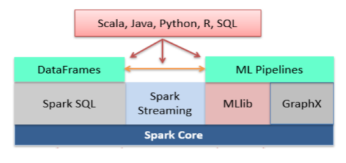
</p>

<p align="center"><em>Figure 24 — Spark Core and higher-level APIs/libraries including SQL, Streaming, ML, GraphX, and language interfaces (source notes, p. 43).</em></p>

## 8.5 PySpark

**PySpark** is the Python API for Apache Spark.

The notes associate PySpark with:

- Distributed data processing
- Data analysis
- Machine learning
- Graph processing at scale
- Large-dataset processing
- Access to Spark functionality for SQL, streaming, MLlib, and GraphX-related workflows

## 8.6 Development history of Spark in the notes

| Year | Event |
|---|---|
| **2009** | Spark was created at UC Berkeley's AMPLab by Matei Zaharia. |
| **2010** | Spark was open-sourced under a BSD license. |
| **2013** | The project moved to the Apache Software Foundation and adopted the Apache 2.0 license. |
| **2014** | Databricks was founded by Spark's original creators to support further development. |
| **Present** | Spark is described in the notes as a widely used framework for batch and real-time data analytics. |

## 8.7 Demand for real-time data analytics

The notes emphasize growing demand for real-time processing of Big Data across many areas of daily life and industry.

Spark supports multiple languages, including:

- Java
- Scala
- Python through PySpark
- R

The notes describe **Scala** as Spark's native language in this course context.

Spark Core supports higher-level components for:

- Structured-data processing
- Streaming analytics
- Machine learning
- Graph computation

## 8.8 Why Spark when Hadoop already exists?

The notes give several motivations.

### 1. Intermediate disk I/O

Hadoop MapReduce writes intermediate results to disk, while Spark can keep reusable data in memory.

The notes state that Spark can be **up to 100× faster in some in-memory cases**.

### 2. Batch vs. real-time analytics

- Hadoop MapReduce is presented mainly as batch processing.
- Spark supports batch processing and streaming analytics.

### 3. Programming APIs

Spark provides APIs in:

- Java
- Scala
- Python
- R

The notes characterize the programming interface as more concise/easier for many analytics tasks than writing low-level MapReduce code.

### 4. Machine learning

- Spark provides MLlib / Spark ML.
- The notes contrast this with external Hadoop-era tools such as Mahout.

### 5. Graph computation

Spark includes GraphX, while the notes state that Hadoop MapReduce itself has no equivalent built-in graph-processing module.

## 8.9 Hadoop job execution in the notes

In the Hadoop/YARN description:

- A user submits a job.
- The NameNode represents storage metadata while the ResourceManager handles cluster compute-resource scheduling.
- DataNodes contain the HDFS blocks on which computation may be scheduled close to data.
- Work is executed in parallel across the cluster.

## 8.10 Hadoop and Spark comparison recorded in the notes

> **Study-note caution:** The following table preserves the comparison statements from the provided notes. Some rows are broad, version-dependent, or environment-dependent, so use this as a transcription of the course material rather than as current Apache product documentation.

| Hadoop | Spark |
|---|---|
| Open source (managed by Apache) | Open source (managed by Apache) |
| A complete package: computing engine (MapReduce), storage (HDFS), resource manager | The notes describe Spark as the computing engine that replaces MapReduce while other layers provide storage/resource management |
| Only batch processing | Both batch and real-time processing |
| Fault-tolerant and scalable | Fault-tolerant and scalable |
| No built-in support for SQL, ML, etc. in the basic Hadoop/MapReduce comparison | Built-in support for SQL, ML, etc. |
| A data-processing and storage engine | A data-processing and data-analytics engine |
| **Recorded in the notes:** runs on a local system as well as a cluster | **Recorded in the notes:** only local system |
| **Recorded in the notes:** operations are lazy in nature | **Recorded in the notes:** results are obtained as soon as an operation is applied |
| API support has comparatively fewer operations | API support has more operations |
| **Recorded in the notes:** DataFrame access is slow but processing is fast | **Recorded in the notes:** DataFrame access is faster but processing is very slow |
| Complicated installation process | Easy installation |
| Programming options are fewer | Programming options are more |

## 8.11 Python vs. Scala for Spark

| Python | Scala |
|---|---|
| Generally slower in the notes' comparison | Described as faster when used directly with Spark |
| Simple syntax and easier to learn | More complex syntax |
| High readability and familiarity for many users | Requires more care with Scala-specific language concepts |
| Rich Python ecosystem for visualization/data science | The notes characterize Scala as having fewer data-science libraries than Python |

## 8.12 Why is Spark faster than Hadoop MapReduce in the notes?

### Hadoop MapReduce

- Writes intermediate results to disk after processing stages.
- Repeated HDFS/local-disk reads and writes increase I/O cost.
- The notes describe no built-in equivalent of Spark-style reusable in-memory caching in basic MapReduce.
- Typical processing uses repeated map/reduce stages with disk materialization between stages.

### Spark

- Uses in-memory computation when data can be retained in RAM.
- Cached data can be reused without repeated disk reads.
- RDDs can be cached using operations such as `cache()`.
- Supports transformations such as `map()`, `join()`, and other reusable computation chains.

<p align="center">
  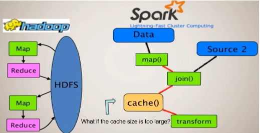
</p>

<p align="center"><em>Figure 25 — Disk-oriented MapReduce workflow compared with Spark's cached/in-memory processing idea (source notes, p. 45).</em></p>

## 8.13 What if Spark's cache is too large?

The notes describe several consequences:

- If cached data exceeds available RAM, the application can run short of memory.
- Spark can spill data to disk, which reduces performance.
- Less-recently-used (**LRU**) data may be evicted to free space in the simplified explanation.
- Heavy memory pressure may trigger frequent garbage-collection pauses.
- Excessive spilling and GC can significantly slow Spark jobs.

---

# 9. Review Questions and Exercises

This section collects the questions that appeared throughout the notes so they can be used for revision.

## HDFS and storage

1. What are the 5Vs of Big Data?
2. How do **latency**, **bandwidth**, and **throughput** differ?
3. Why is HDFS designed around a write-once/read-many access pattern?
4. Why do very small HDFS blocks increase NameNode overhead?
5. What are the trade-offs between large and small HDFS block sizes?
6. If a file has **B blocks**, each on a different machine with disk throughput **T**, why is aggregate read throughput **B × T**?
7. If **B blocks** are distributed across **N machines**, each with throughput **T**, why does the simplified aggregate throughput become **N × T**?
8. What metadata does the NameNode store?
9. What is the role of the DataNode?
10. Why do DataNodes send heartbeats?
11. Why is block replication needed?
12. Why is rack-aware replica placement useful?
13. Why should recent block creation be spread across machines?
14. For a **10 TB** file, **64 MB** blocks, and replication factor **3**, determine block count and storage requirements.
15. What happens when a block fails?
16. What happens when a DataNode fails?
17. How do replication and machine-failure probability affect the chance of losing a file?
18. What is rebalancing?
19. Which blocks can be removed during garbage collection?
20. How do checksums help detect corruption?
21. What are FsImage and EditLogs?
22. Why are checkpoints needed?
23. What is the difference between a backup node and a standby node in the notes?
24. Why can one NameNode become a scalability bottleneck?
25. How does HDFS Federation address that bottleneck?
26. Explain the HDFS file-read process.
27. Explain the HDFS file-write pipeline.
28. What is a block lease?
29. What roles do RPC, HTTP, and TCP play in the notes' HDFS architecture?

## Parallel processing and MapReduce

30. Why can a global shared map cause race conditions in a multithreaded word-count program?
31. Why can a map-per-thread design reduce synchronization overhead?
32. Why is distributed processing more suitable for very large files?
33. What does “move computation to data” mean?
34. What are the Map and Reduce phases?
35. What happens during shuffle and sort?
36. What is an input split?
37. What do InputFormat and RecordReader do?
38. What are the trade-offs between smaller and larger splits?
39. What is data locality?
40. What happens if the local node has insufficient compute resources for a map task?
41. Why are intermediate results grouped, sorted, and partitioned?
42. What happens when mapper intermediate data is too large for memory?
43. Explain spill, shuffle, and merge.
44. How does a multi-round multi-way merge work?
45. Why are temporary mapper outputs not normally stored in HDFS?
46. How should the number of reducers be chosen?
47. What are the responsibilities of JobTracker and TaskTracker?
48. What happens when the JobTracker fails?
49. What happens when a TaskTracker fails?
50. How are failed map or reduce tasks recovered?
51. What causes straggler latency?
52. How does speculative execution reduce straggler impact?
53. Which distributed-systems details does MapReduce hide from the programmer?
54. When is MapReduce a poor fit?

## YARN

55. What problem does YARN solve compared with Hadoop 1.0's JobTracker/TaskTracker architecture?
56. What does the ResourceManager do?
57. What does a NodeManager do?
58. What is a container?
59. What does an ApplicationMaster do?
60. Explain the full YARN application-execution sequence.
61. How are ApplicationMaster and NodeManager failures detected?
62. What features of YARN support multi-application clusters?

## Spark

63. What is an RDD?
64. What are Spark Core, Spark SQL, Spark Streaming, MLlib/Spark ML, and GraphX?
65. What is PySpark?
66. Which languages are supported in the notes' Spark discussion?
67. Why can Spark outperform disk-heavy MapReduce workflows?
68. Why is caching useful?
69. What happens when cached data is larger than available memory?
70. What are the Python-vs-Scala trade-offs described in the notes?

---

# 10. Figure Index

All visual figures from the source notes have been preserved.

| Figure | Topic | Source-note page | File |
|---:|---|---:|---|
| 1 | Hadoop layered architecture | 2 | `01-hadoop-layered-architecture.png` |
| 2 | Hadoop cluster: MapReduce + HDFS | 2 | `02-hadoop-cluster-mapreduce-hdfs.png` |
| 3 | Rack/core-switch cluster | 3 | `03-rack-and-core-switch-cluster.png` |
| 4 | HDFS master–slave architecture | 8 | `04-hdfs-master-slave-architecture.png` |
| 5 | Data-center rack structure | 11 | `05-datacenter-rack-structure.png` |
| 6 | NameNode replication strategies | 16 | `06-namenode-replication-strategies.png` |
| 7 | HDFS Federation | 17 | `07-hdfs-federation.png` |
| 8 | Client/NameNode/DataNode interaction | 18 | `08-hdfs-client-namenode-datanode-interaction.png` |
| 9 | Write control and data flow | 19 | `09-hdfs-write-control-data-flow.png` |
| 10 | Basic MapReduce dataflow | 23 | `10-mapreduce-basic-dataflow.png` |
| 11 | Word-count shuffle/sort example | 23 | `11-mapreduce-wordcount-shuffle-sort.png` |
| 12 | Detailed MapReduce workflow | 24 | `12-mapreduce-detailed-workflow.png` |
| 13 | HDFS blocks read into memory | 25 | `13-hdfs-blocks-read-into-memory.png` |
| 14 | Block distribution and execution | 26 | `14-mapreduce-block-distribution-execution.png` |
| 15 | Input splits to map tasks | 28 | `15-input-splits-to-map-tasks.png` |
| 16 | Insufficient compute resources | 28 | `16-map-task-resource-shortage.png` |
| 17 | Locality fallback | 28 | `17-map-task-locality-fallback.png` |
| 18 | JobTracker/TaskTracker architecture | 32 | `18-hadoop1-jobtracker-tasktracker-architecture.png` |
| 19 | Hadoop 1 vs Hadoop 2 stack | 35 | `19-hadoop1-vs-hadoop2-stack.png` |
| 20 | Storage/resource/processing units | 36 | `20-hadoop-storage-resource-processing-units.png` |
| 21 | JobTracker/TaskTracker flow | 37 | `21-jobtracker-tasktracker-flow.png` |
| 22 | YARN RM and NodeManagers | 38 | `22-yarn-resource-manager-node-managers.png` |
| 23 | YARN application flow | 40 | `23-yarn-application-execution-flow.png` |
| 24 | Spark ecosystem | 43 | `24-apache-spark-ecosystem.png` |
| 25 | Hadoop vs Spark caching | 45 | `25-hadoop-vs-spark-caching.png` |

---

# 11. Repository Structure

```text
CSCI-545-745-Big-Data-Analytics-Notes/
│
├── README.md
├── COPYRIGHT.md
└── assets/
    └── figures/
        ├── 01-hadoop-layered-architecture.png
        ├── 02-hadoop-cluster-mapreduce-hdfs.png
        ├── ...
        └── 25-hadoop-vs-spark-caching.png
```

The original PDF is intentionally **not included**. The repository is designed to be read directly on GitHub.

---

# 12. Usage and Copyright

These notes are presented for **study and educational reference**. No open-source license is granted for copying, redistribution, republication, or commercial reuse of the compiled notes.

Some diagrams reproduced from the source notes may have separate original creators or rights holders. Their inclusion here is for educational context; ownership of third-party visual material remains with the respective rights holders.

See [`COPYRIGHT.md`](COPYRIGHT.md) for the repository notice.

---

<div align="center">

**CSCI 545 / 745 — Big Data Analytics**  
*Big Data → Hadoop → HDFS → MapReduce → YARN → Spark*

</div>
